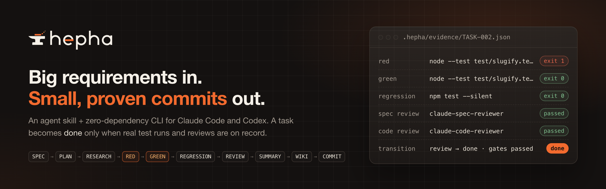
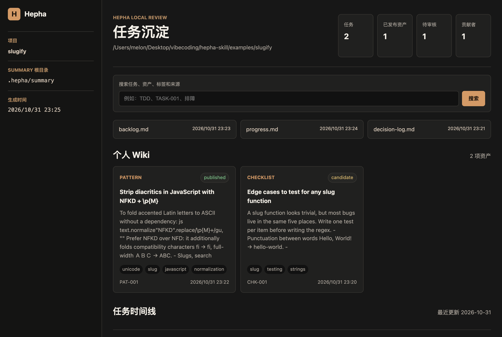
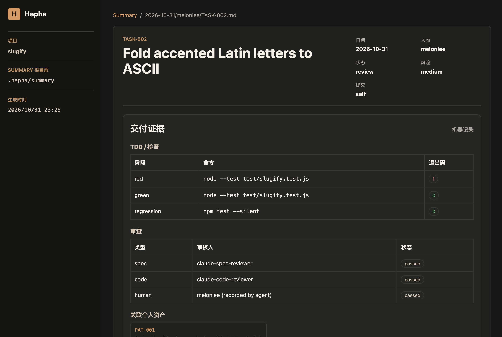
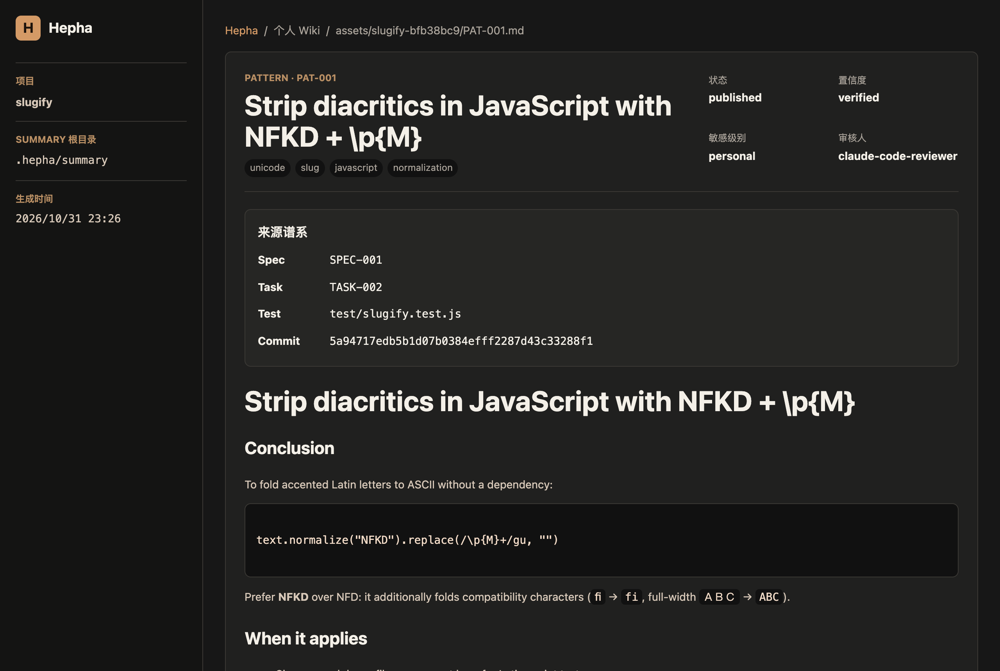
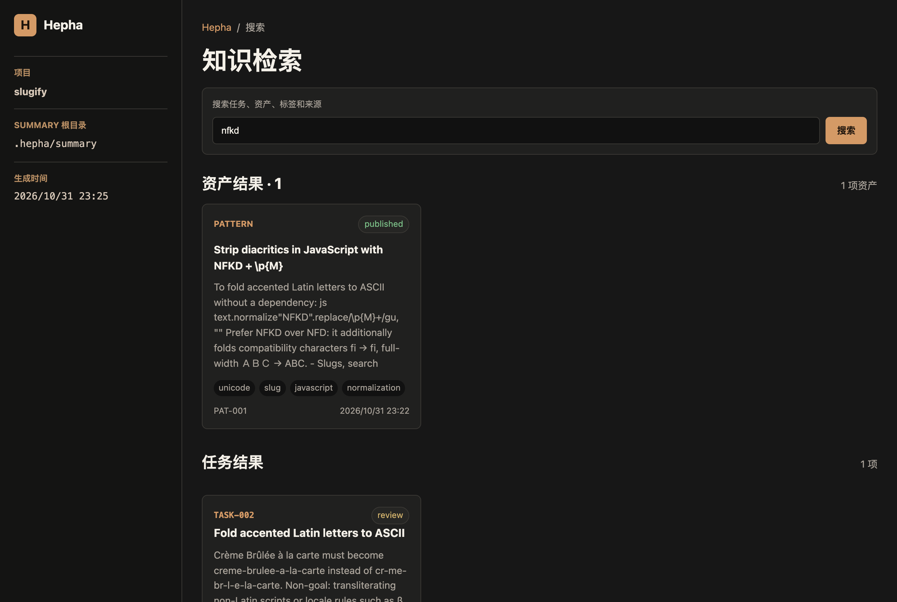
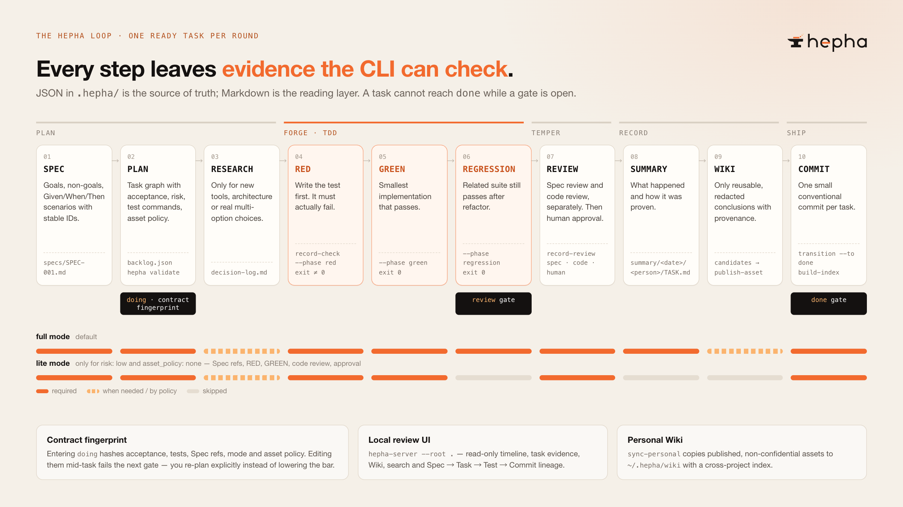

<p align="center">
  
</p>

<p align="center">
  <a href="https://github.com/melonlee/hepha-skill/actions/workflows/ci.yml"></a>
  <a href="https://github.com/melonlee/hepha-skill/stargazers"></a>
  <a href="./LICENSE"></a>
  = 18" />
  
  
</p>

<p align="center">
  <strong>English</strong> · <a href="./README.zh-CN.md">简体中文</a>
</p>

<p align="center">
  <b>Hepha is an agent skill plus a zero-dependency CLI. It breaks a large requirement into small tasks, and a task only counts as done when real test runs and separate reviews are on record.</b>
</p>

<p align="center">
  <a href="#quick-start">Quick start</a> ·
  <a href="./examples">Worked example</a> ·
  <a href="#how-it-works">How it works</a> ·
  <a href="#cli-reference">CLI</a> ·
  <a href="#how-hepha-compares">Comparison</a> ·
  <a href="#faq">FAQ</a>
</p>

---

## Why Hepha

A long agent session leaves you with a big diff, a transcript and a confident "all tests pass". Afterwards, you can only check the diff and what the agent *said*.

Hepha changes what is left on disk. The agent still writes the Spec, the code and the notes. The CLI runs your test commands and records the results, records the reviews, and refuses to move a task forward while evidence is missing.

| After the run, can you check… | One long agent session | A Hepha run |
|---|---|---|
| …what behaviour was agreed? | The prompt, maybe | `specs/SPEC-*.md` with scenario IDs. Each task has Given/When/Then acceptance criteria, fingerprinted when work starts |
| …that a test failed *before* the fix? | Only if it happened and you find it in the transcript | `evidence/TASK-*.json` holds the RED command, its non-zero exit code and output |
| …that tests pass now? | The agent's statement | GREEN and regression records, plus `test_plan.commands` you can rerun |
| …that Spec and code were reviewed? | Usually mixed into one pass, or skipped | Separate `spec`, `code` and `human` review records with reviewer and notes |
| …which commit did what? | One large diff | One small commit per task, and assets linked Spec → Task → Test → Commit |
| …what is worth reusing? | Buried in the transcript | A dated summary plus reviewed Wiki assets, searchable across projects |

**What Hepha does not do:** it cannot judge whether a test is *meaningful* or a review was *thorough*. It proves that commands ran with the recorded results and that each review step was explicitly recorded. Treat it as an audit trail and a guard rail, not a substitute for judgement.

## See it work

[`examples/slugify`](./examples) is a small library built from an empty folder **using only the Hepha CLI**: three tasks, two full and one lite. Its `.hepha/` folder is the real output of that run, including two gate refusals. Dogfooding it also [found and fixed a bug in Hepha itself](./examples#a-bug-the-example-found-in-hepha). CI re-checks the example's gates on every push.

<table>
  <tr>
    <td width="50%"><br/><sub><b>Overview</b>: artifacts, Wiki cards, candidate queue, timeline</sub></td>
    <td width="50%"><br/><sub><b>Task</b>: recorded RED/GREEN/regression and spec/code/human reviews</sub></td>
  </tr>
  <tr>
    <td width="50%"><br/><sub><b>Wiki asset</b>: lineage resolved to a real commit hash</sub></td>
    <td width="50%"><br/><sub><b>Search</b>: across tasks, assets, tags and source IDs</sub></td>
  </tr>
</table>

<sub>Screenshots of <code>hepha-server</code> running on <code>examples/slugify</code>. The UI labels are in Chinese; your content can be in any language.</sub>

## Quick start

**1. Install the skill**: clone once, then link it where your agent looks for skills.

```bash
git clone https://github.com/melonlee/hepha-skill.git
cd hepha-skill

# Claude Code: personal skill, available in all your projects
mkdir -p ~/.claude/skills && ln -s "$PWD/skills/hepha" ~/.claude/skills/hepha

# Codex: user-level skill
mkdir -p ~/.agents/skills && ln -s "$PWD/skills/hepha" ~/.agents/skills/hepha
```

<details>
<summary>Other options: project-level install, copying instead of linking, the guard rule</summary>

- **Claude Code, one project only:** put the skill in the project's `.claude/skills/` and commit it so your team gets it too:
  `mkdir -p .claude/skills && cp -R /path/to/hepha-skill/skills/hepha .claude/skills/hepha`
- **Copy instead of symlink:** `cp -R skills/hepha ~/.claude/skills/hepha`. Claude Code also accepts symlinked skill folders in the personal and project locations.
- **Guard rule (optional, recommended):** [`rules/hepha-guard.mdc`](./rules/hepha-guard.mdc) restates the hard stops in a short form. For Claude Code, copy it to `.claude/rules/hepha-guard.md`. For Cursor, copy it to `.cursor/rules/`. For Codex, paste it into `AGENTS.md`.
- **Skill paths in the docs:** `<skill-root>` in `SKILL.md` means wherever you installed `skills/hepha`, e.g. `~/.claude/skills/hepha`.

</details>

**2. Ask your agent to run it.** The skill is never triggered implicitly. Invoke it explicitly: `/hepha` in Claude Code, `$hepha` in Codex.

```text
/hepha Build CSV export for the orders page.
Use English for specs and summaries. Ask me before marking any task done.
```

The agent initialises `.hepha/`, writes the Spec and a validated backlog, then works one task per loop. It calls the CLI to record evidence and to request state changes.

**3. Review what happened.**

```bash
node ~/.claude/skills/hepha/scripts/hepha-server.js --root . --port 3000   # open http://localhost:3000
```

The server is read-only. It binds to `127.0.0.1` by default.

<details>
<summary>Installing from npm (after the package is published)</summary>

`package.json` already declares the `hepha` and `hepha-server` bins, and a tarball built with `npm pack` passes a smoke test. The package is **not on npm yet**. Once it is published, you will be able to run:

```bash
npx -p hepha-skill hepha init --root . --requirement "..."   # one-off
npm i -g hepha-skill                                          # or global: `hepha`, `hepha-server`
ln -s "$(npm root -g)/hepha-skill/skills/hepha" ~/.claude/skills/hepha
```

</details>

## How it works

<p align="center">
  
</p>

Each loop runs **one ready task** through:

`SPEC → PLAN → RESEARCH → RED → GREEN → REGRESSION → REVIEW → SUMMARY → WIKI → COMMIT`

- **SPEC / PLAN**: goals, non-goals, scenarios with stable IDs. Every task needs `spec_refs`, Given/When/Then `acceptance`, `risk`, `test_plan.commands` and a `knowledge.asset_policy`. `hepha validate` checks the schema, the references and the dependency DAG.
- **RESEARCH**: only for a new tool, an architecture change, a security or migration risk, or a real multi-option choice. Trade-offs go into `decision-log.md`.
- **RED → GREEN → REGRESSION**: `hepha record-check` *executes* the command and stores the command, exit code and output. A RED run must fail.
- **REVIEW**: Spec review and code review are recorded separately, plus human approval by default. If the host allows sub-agents, they run in isolated contexts.
- **SUMMARY / WIKI**: a factual summary per task. Reusable conclusions become Wiki candidates and are published only after review and a secret scan.
- **COMMIT**: one small conventional commit per task, then the indexes are rebuilt and assets synced.

### The gates

`hepha transition` enforces `todo → doing → review → done` (plus `blocked`/`skipped`) and checks evidence at every step:

| Transition | Refused unless |
|---|---|
| `→ doing` | All dependencies are `done`. The task contract (acceptance, tests, Spec refs, mode, asset policy) gets fingerprinted |
| `→ review` | A failing RED run, a passing GREEN run and a passing regression run are recorded, and the contract fingerprint is unchanged |
| `→ done` | Spec review and code review passed, human approval is recorded (unless the manifest sets `approval_required: false`), the summary exists, and the asset policy is met |

### Lite mode

Small, low-risk changes can declare `"mode": "lite"`. The validator accepts lite only with `risk: "low"` and `asset_policy: "none"`.

| Gate | `full` (default) | `lite` |
|---|---|---|
| Spec refs + Given/When/Then | ✓ | ✓ |
| RED + GREEN | ✓ | ✓ |
| Regression run | ✓ | – |
| Spec review | ✓ | – |
| Code review + approval | ✓ | ✓ |
| Summary | ✓ | – |
| Wiki asset | per policy | not allowed |

Because `mode` is part of the fingerprinted contract, a task cannot switch to lite halfway through.

### Evidence, summary and personal Wiki

| Layer | Answers | Where |
|---|---|---|
| Evidence | What ran and with what result? | `.hepha/evidence/TASK-*.json` |
| Summary | What happened in this loop? | `.hepha/summary/YYYY-MM-DD/<person>/TASK-*.md` |
| Wiki asset | What should I reuse, and where does it *not* apply? | `.hepha/wiki/assets/*.md` |
| Personal index | Where did I learn this, and how trustworthy is it? | `~/.hepha/wiki/index.json` |

Assets carry `source_specs`, `source_tasks`, `source_tests` and `source_commits`. Before the commit exists, use `source_commits: [self]`. `sync-personal` then resolves it to the hash of the latest commit that touched the asset. Assets marked `project-confidential` never leave the project. Lifecycle: `candidate → reviewed → published → stale → superseded`.

<details>
<summary>Runtime layout</summary>

```text
.hepha/
├── manifest.json                         # requirement, owner, approval policy
├── backlog.json                          # machine fact source
├── backlog.md                            # rendered reading view
├── progress.md · decision-log.md
├── specs/SPEC-XXX.md
├── evidence/TASK-XXX.json                # checks, reviews, contract fingerprint
├── summary/YYYY-MM-DD/<person>/TASK.md
├── wiki/candidates/*.md · wiki/assets/*.md · wiki/index.json
└── index.json                            # task + asset search index
```

</details>

## CLI reference

Run it from a clone with `node skills/hepha/scripts/hepha-cli.js <command>`, or as `hepha <command>` once installed from npm. Every command accepts `--root <project>`.

| Command | Purpose |
|---|---|
| `init --requirement "…" [--person NAME]` | Create `.hepha/`, the manifest, an empty backlog and a starter Spec |
| `validate [--allow-empty]` | Check backlog schema, Spec references, modes and the dependency DAG |
| `record-check --task T --phase red\|green\|regression\|lint\|build\|browser --command "…"` | Run the command and record its exit code and output. RED must fail, the other phases must pass |
| `record-review --task T --type spec\|code\|human --status passed\|failed\|changes-requested [--reviewer N] [--notes "…"]` | Record a review |
| `transition --task T --to doing\|review\|done\|blocked\|skipped` | Change state if the gates pass |
| `publish-asset --file .hepha/wiki/candidates/X.md [--reviewer N]` | Validate, scan for secrets and publish a Wiki asset |
| `build-index` | Rebuild the task and asset indexes |
| `sync-personal [--wiki-root DIR]` | Copy published, non-confidential assets to the personal Wiki |
| `version` | Print the version |
| `hepha-server [--port 3000] [--host 127.0.0.1] [--wiki-root DIR]` | Read-only local review UI |

Environment: `HEPHA_PERSON`, `HEPHA_WIKI_ROOT`, `HEPHA_PORT`, `HEPHA_HOST`.

## How Hepha compares

Hepha borrows the Spec-first and TDD discipline popularised by [Superpowers](https://github.com/obra/superpowers) and [Spec Kit](https://github.com/github/spec-kit). All three are useful, and they solve different problems. This comparison is based on their READMEs as of October 2026. Corrections are welcome.

| | Superpowers | Spec Kit | Hepha |
|---|---|---|---|
| **What it is** | A methodology delivered as a library of composable skills (brainstorming, plans, worktrees, subagent-driven development, TDD, code review…) | An open source toolkit with a Python CLI (`specify`), templates and agent commands for SDD, bug fixing and idea assessment | One delivery skill + one guard rule + a zero-dependency Node CLI |
| **Scope** | Broad SDLC coverage, many harnesses | Many processes and agents; extensions, presets, workflows and catalogs for teams | Deliberately narrow: one loop for one person's delivery |
| **Install** | Plugin marketplaces (Claude Code, Codex, Cursor, Gemini CLI, …) | `uv tool install specify-cli` | Symlink or copy a folder (npm package prepared, not yet published) |
| **Where enforcement lives** | Skill instructions that trigger automatically | Commands, templates and optional extension gates | A CLI state machine that reads recorded evidence and exits non-zero when it is missing |
| **Test evidence** | TDD skill: watch the test fail, then pass | Depends on the chosen process / extensions | RED/GREEN/regression command, exit code and output stored per task |
| **Knowledge capture** | Design docs and plans | Specs, plans and tasks as Markdown artifacts | Summaries + reviewed Wiki assets with Spec/Task/Test/Commit provenance, synced across projects |
| **Review surface** | Your agent / PRs | Your agent / generated artifacts | Local read-only HTML: timeline, evidence, search, lineage |

**Rough guide:** pick Superpowers for a broad, auto-triggering skill set across many agents. Pick Spec Kit for team-wide, customisable spec-driven processes. Pick Hepha for a small, auditable loop where "done" means the evidence is on disk, plus a personal knowledge trail. You can combine Hepha with either of them.

## FAQ

<details>
<summary><b>Does this slow the agent down?</b></summary>

Yes, somewhat. Writing a failing test first and recording two reviews costs time. Lite mode exists for the small changes where that cost isn't worth it. Hepha is meant for work where finding a bad change late costs more than the extra steps.
</details>

<details>
<summary><b>Can't the agent just fake the evidence?</b></summary>

`record-check` runs the command itself and records the real exit code, and the gates read those records. Nothing stops a determined agent from editing the JSON directly, so the evidence is only as trustworthy as your process. The guard rule forbids hand-editing it, and you can rerun every recorded command. Hepha makes cutting corners visible and costly. It cannot make it impossible.
</details>

<details>
<summary><b>Which agents does it work with?</b></summary>

It's built for Claude Code and Codex, which both have native skill folders. The CLI is plain Node, so any agent that can read `SKILL.md` and run shell commands can follow the protocol.
</details>

<details>
<summary><b>Why are the CLI messages and templates in Chinese?</b></summary>

The skill started as Chinese-first for its author's team. Specs, summaries and assets can be written in any language; the example in this repo is in English. Localising the CLI messages is on the wish list, and PRs are welcome.
</details>

<details>
<summary><b>Does it commit or push for me?</b></summary>

The skill asks for one small conventional commit per task, following the commit policy you approve. Human approval is required by default. The CLI itself never commits. Its only git calls are read-only: `git config user.name` (default person name) and `git log` (`sync-personal` uses it to resolve `self` commit references).
</details>

<details>
<summary><b>Where does my data go?</b></summary>

Nowhere. Everything lives in `.hepha/` in your project and, if you sync, in `~/.hepha/wiki`. The review server only binds to localhost, accepts only GET/HEAD and sends restrictive security headers.
</details>

## Documentation

- [Worked example and walkthrough](./examples)
- [Skill definition (`SKILL.md`)](./skills/hepha/SKILL.md) · [Guard rule](./rules/hepha-guard.mdc)
- [Runtime schema](./skills/hepha/references/runtime-schema.md) · [Spec, TDD and role isolation](./skills/hepha/references/spec-tdd-sdd.md) · [Quality gates](./skills/hepha/references/validation_quality-gates.md)
- [Personal Wiki and asset lifecycle](./skills/hepha/references/personal-wiki.md) · [Decomposition patterns](./skills/hepha/references/decomposition-patterns.md)
- [Changelog](./CHANGELOG.md) · [Brand assets](./docs/assets/brand) · [ClawHub page](https://clawhub.ai/melonlee/hepha-skill)

## Contributing

```bash
npm test   # node:test, no install needed: runtime, CLI, server, lite mode and the example's gates
```

Issues and PRs are welcome. Behaviour changes to the CLI should come with a test, and ideally a failing one first.

## Star history

<a href="https://www.star-history.com/#melonlee/hepha-skill&Date">
  <picture>
    <source media="(prefers-color-scheme: dark)" srcset="https://api.star-history.com/svg?repos=melonlee/hepha-skill&type=Date&theme=dark" />
    
  </picture>
</a>

## License

[MIT](./LICENSE) © melonlee
