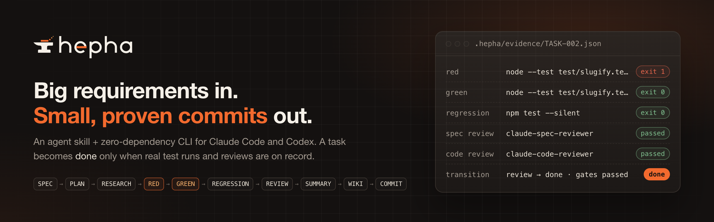
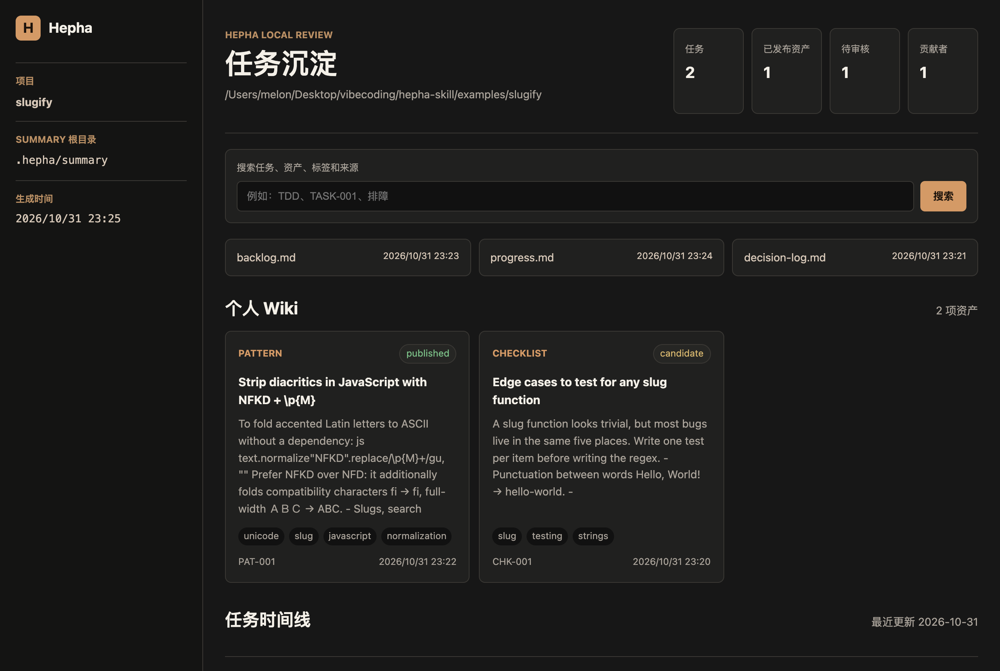
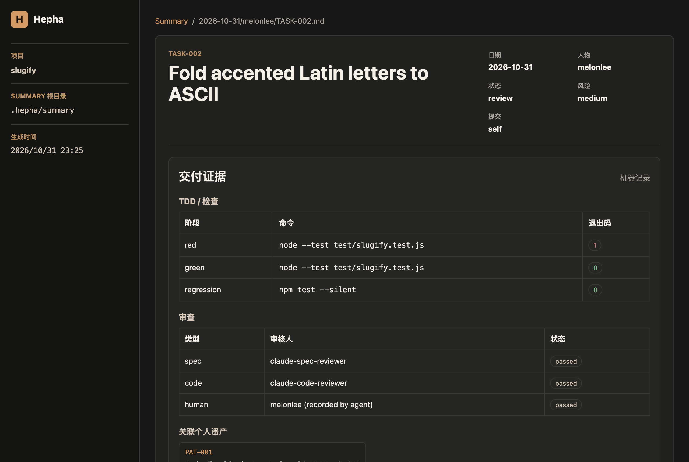
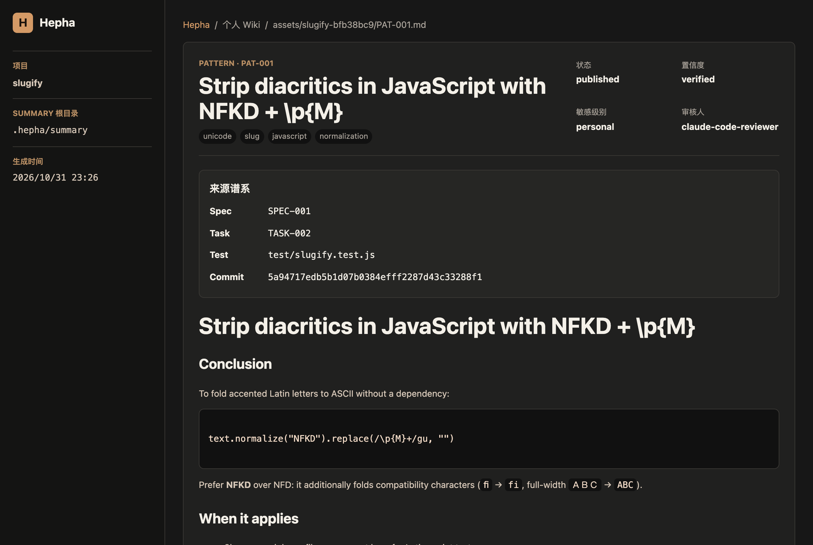
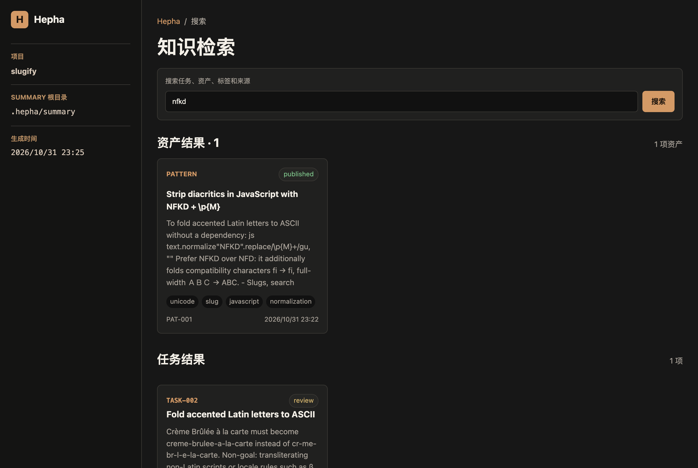
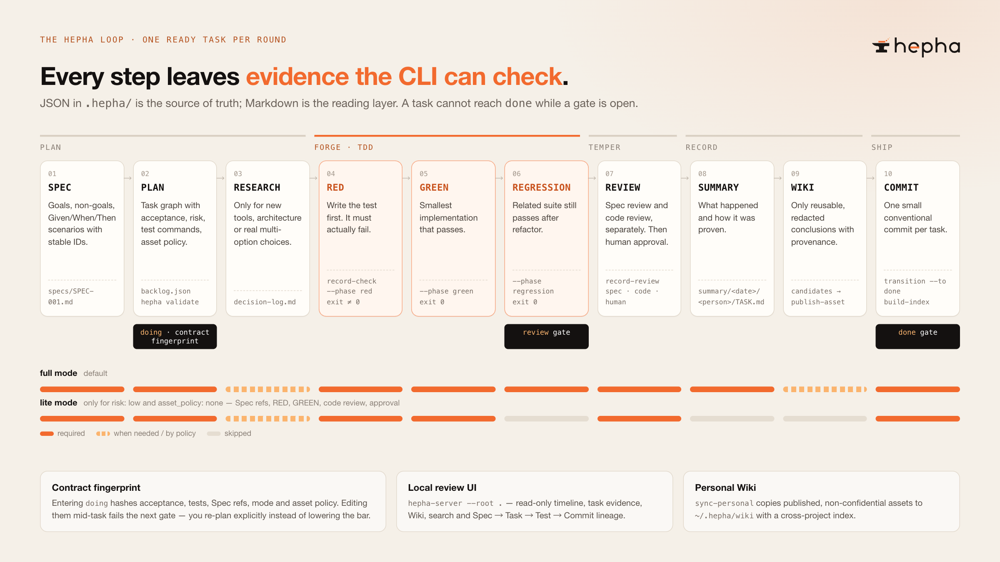

<p align="center">
  
</p>

<p align="center">
  <a href="https://github.com/melonlee/hepha-skill/actions/workflows/ci.yml"></a>
  <a href="https://github.com/melonlee/hepha-skill/stargazers"></a>
  <a href="./LICENSE"></a>
  = 18" />
  
  
</p>

<p align="center">
  <a href="./README.md">English</a> · <strong>简体中文</strong>
</p>

<p align="center">
  <b>Hepha 是一个 Agent Skill，配一个零依赖 CLI：把大需求拆成小任务，只有真实测试记录和分开的审查都齐了，任务才算完成。</b>
</p>

<p align="center">
  <a href="#快速开始">快速开始</a> ·
  <a href="./examples">真实示例</a> ·
  <a href="#工作原理">工作原理</a> ·
  <a href="#cli-参考">CLI</a> ·
  <a href="#与同类项目对比">对比</a> ·
  <a href="#常见问题">FAQ</a>
</p>

---

## 为什么需要 Hepha

让 Agent 连续跑一个大需求，最后留给你的是一大坨 diff、一长串对话，和一句很自信的“测试都通过了”。事后能检查的，只有 diff 和 Agent *说过的话*。

Hepha 改变的是跑完之后磁盘上留下了什么。Spec、代码和记录仍然由 Agent 来写；测试命令由 CLI 执行并记录结果，审查也由 CLI 记录。证据不全时，CLI 会拒绝推进任务状态。

| 跑完之后，你能核实…… | 一次长时间 Agent 会话 | 一次 Hepha 交付 |
|---|---|---|
| ……当初约定的行为是什么？ | 也许在提示词里 | `specs/SPEC-*.md` 里有带编号的场景；每个任务有 Given/When/Then 验收条件，开工时固化指纹 |
| ……修复之前测试真的失败过？ | 碰巧做过、又能在对话里翻到才行 | `evidence/TASK-*.json` 里有 RED 的命令、非零退出码和输出 |
| ……现在测试是通过的？ | Agent 的一句话 | GREEN、regression 记录，以及可以重跑的 `test_plan.commands` |
| ……Spec 和代码都审过？ | 通常混在一起，或者干脆跳过 | `spec`、`code`、`human` 三条独立审查记录，带审查人和备注 |
| ……哪个提交做了什么？ | 一个大 diff | 一个任务一个小提交；资产能追溯 Spec → Task → Test → Commit |
| ……哪些值得复用？ | 埋在对话里 | 按日期归档的 Summary，加上审核过、可以跨项目检索的 Wiki 资产 |

**Hepha 做不到的事**：它判断不了测试*有没有意义*、审查*是否认真*。它能证明命令确实跑过、结果就是记录里那样，也能证明每一步审查都被显式记录了。把它当作审计记录和护栏，而不是判断力的替代品。

## 实际效果

[`examples/slugify`](./examples) 是一个从空目录开始、**只用 Hepha CLI** 完成的小型库：3 个任务，2 个 full、1 个 lite。它的 `.hepha/` 目录就是那次运行的真实产物，里面还保留了两次门禁拒绝。跑这个示例时还[发现并修复了 Hepha 自身的一个 bug](./examples#a-bug-the-example-found-in-hepha)。CI 每次运行都会重新校验示例的全部门禁。

<table>
  <tr>
    <td width="50%"><br/><sub><b>概览</b>：运行产物、Wiki 卡片、候选队列、任务时间线</sub></td>
    <td width="50%"><br/><sub><b>任务详情</b>：RED/GREEN/regression 记录与 spec/code/human 审查</sub></td>
  </tr>
  <tr>
    <td width="50%"><br/><sub><b>Wiki 资产</b>：来源谱系已解析为真实 commit hash</sub></td>
    <td width="50%"><br/><sub><b>搜索</b>：覆盖任务、资产、标签和来源 ID</sub></td>
  </tr>
</table>

<sub>以上为 <code>hepha-server</code> 在 <code>examples/slugify</code> 上的真实截图。</sub>

## 快速开始

**1. 安装 Skill**：克隆一次，再链接到 Agent 读取 Skill 的目录。

```bash
git clone https://github.com/melonlee/hepha-skill.git
cd hepha-skill

# Claude Code：个人级 Skill，对所有项目生效
mkdir -p ~/.claude/skills && ln -s "$PWD/skills/hepha" ~/.claude/skills/hepha

# Codex：用户级 Skill
mkdir -p ~/.agents/skills && ln -s "$PWD/skills/hepha" ~/.agents/skills/hepha
```

<details>
<summary>其他方式：项目级安装、复制代替链接、守卫规则</summary>

- **Claude Code 仅对单个项目生效**：放进项目的 `.claude/skills/` 并提交，团队成员也能用：
  `mkdir -p .claude/skills && cp -R /path/to/hepha-skill/skills/hepha .claude/skills/hepha`
- **复制代替软链接**：`cp -R skills/hepha ~/.claude/skills/hepha`。Claude Code 的个人级和项目级 Skill 目录也支持软链接目录。
- **守卫规则（可选，推荐）**：[`rules/hepha-guard.mdc`](./rules/hepha-guard.mdc) 是硬性门禁的精简版。Claude Code 复制到 `.claude/rules/hepha-guard.md`，Cursor 放进 `.cursor/rules/`，Codex 写进 `AGENTS.md`。
- **路径约定**：`SKILL.md` 里的 `<skill-root>` 指 `skills/hepha` 的安装位置，例如 `~/.claude/skills/hepha`。

</details>

**2. 让 Agent 运行它。** Skill 不会被隐式触发，需要显式调用：Claude Code 用 `/hepha`，Codex 用 `$hepha`。

```text
/hepha 为订单页实现 CSV 导出。
Spec 和 Summary 用中文；任何任务标记完成前先问我。
```

Agent 会初始化 `.hepha/`，写 Spec 和通过校验的 backlog，然后每轮做一个任务。记录证据、推进任务状态，都通过调用 CLI 完成。

**3. 回看过程。**

```bash
node ~/.claude/skills/hepha/scripts/hepha-server.js --root . --port 3000   # 打开 http://localhost:3000
```

服务是只读的，默认只绑定 `127.0.0.1`。

<details>
<summary>通过 npm 安装（发布之后）</summary>

`package.json` 已经声明了 `hepha` 和 `hepha-server` 两个命令，`npm pack` 打出的包也通过了冒烟测试，但**目前还没有发布到 npm**。发布之后可以：

```bash
npx -p hepha-skill hepha init --root . --requirement "..."   # 一次性使用
npm i -g hepha-skill                                          # 或全局安装：hepha、hepha-server
ln -s "$(npm root -g)/hepha-skill/skills/hepha" ~/.claude/skills/hepha
```

</details>

## 工作原理

<p align="center">
  
</p>

每一轮只处理**一个就绪任务**：

`SPEC → PLAN → RESEARCH → RED → GREEN → REGRESSION → REVIEW → SUMMARY → WIKI → COMMIT`

- **SPEC / PLAN**：写清目标、非目标，以及带稳定编号的行为场景。每个任务都要有 `spec_refs`、Given/When/Then 形式的 `acceptance`、`risk`、`test_plan.commands` 和 `knowledge.asset_policy`。`hepha validate` 会校验字段、引用和依赖 DAG。
- **RESEARCH**：只在引入新工具、架构变更、安全或迁移风险、确实存在多个方案时才做，取舍写进 `decision-log.md`。
- **RED → GREEN → REGRESSION**：`hepha record-check` 会*亲自执行*命令，保存命令、退出码和输出。RED 必须失败。
- **REVIEW**：Spec 审查和代码审查分开记录，默认还要人工批准。宿主允许子代理时，审查放在独立上下文里进行。
- **SUMMARY / WIKI**：每个任务写一份事实性的 Summary；可复用的结论先成为候选，经过审核和敏感信息检查才发布。
- **COMMIT**：一个任务一个最小的 conventional commit，然后重建索引、同步资产。

### 门禁

`hepha transition` 负责 `todo → doing → review → done` 状态机（另有 `blocked`/`skipped`），每一步都检查证据：

| 状态转换 | 满足以下条件才放行 |
|---|---|
| `→ doing` | 依赖任务全部 `done`；同时固化任务契约指纹（验收、测试、Spec 引用、模式、资产策略） |
| `→ review` | 记录里有失败的 RED、通过的 GREEN 和通过的 regression；契约指纹没有变化 |
| `→ done` | Spec 审查和代码审查通过，有人工批准（除非 manifest 设置了 `approval_required: false`），Summary 存在，资产策略满足 |

### lite 模式

小而低风险的改动可以声明 `"mode": "lite"`。只有 `risk: "low"` 且 `asset_policy: "none"` 时，validator 才接受 lite。

| 门禁 | `full`（默认） | `lite` |
|---|---|---|
| Spec 引用 + Given/When/Then | ✓ | ✓ |
| RED + GREEN | ✓ | ✓ |
| regression | ✓ | – |
| Spec 审查 | ✓ | – |
| 代码审查 + 批准 | ✓ | ✓ |
| Summary | ✓ | – |
| Wiki 资产 | 按策略 | 不允许 |

`mode` 属于被固化的任务契约，任务执行到一半不能改成 lite 来绕过门禁。

### 证据、Summary 与个人 Wiki

| 层 | 回答的问题 | 位置 |
|---|---|---|
| Evidence | 跑了什么、结果如何？ | `.hepha/evidence/TASK-*.json` |
| Summary | 这一轮发生了什么？ | `.hepha/summary/YYYY-MM-DD/<person>/TASK-*.md` |
| Wiki 资产 | 以后能复用什么，*哪些场景不适用*？ | `.hepha/wiki/assets/*.md` |
| 个人索引 | 这条经验从哪来，可信度如何？ | `~/.hepha/wiki/index.json` |

资产带有 `source_specs`、`source_tasks`、`source_tests`、`source_commits` 四类来源。提交之前写 `source_commits: [self]`，`sync-personal` 会把它解析成最近一次改动该资产文件的提交 hash。标为 `project-confidential` 的资产不会离开项目。生命周期：`candidate → reviewed → published → stale → superseded`。

<details>
<summary>运行时目录结构</summary>

```text
.hepha/
├── manifest.json                         # 需求、负责人、批准策略
├── backlog.json                          # 机器事实源
├── backlog.md                            # 生成的阅读视图
├── progress.md · decision-log.md
├── specs/SPEC-XXX.md
├── evidence/TASK-XXX.json                # 检查、审查、契约指纹
├── summary/YYYY-MM-DD/<person>/TASK.md
├── wiki/candidates/*.md · wiki/assets/*.md · wiki/index.json
└── index.json                            # 任务与资产检索索引
```

</details>

## CLI 参考

在克隆的仓库里用 `node skills/hepha/scripts/hepha-cli.js <command>`；通过 npm 安装后可以直接用 `hepha <command>`。所有命令都支持 `--root <项目目录>`。

| 命令 | 作用 |
|---|---|
| `init --requirement "…" [--person NAME]` | 创建 `.hepha/`、manifest、空 backlog 和 Spec 起始文件 |
| `validate [--allow-empty]` | 校验 backlog Schema、Spec 引用、模式和依赖 DAG |
| `record-check --task T --phase red\|green\|regression\|lint\|build\|browser --command "…"` | 执行命令并记录退出码和输出；RED 必须失败，其余阶段必须通过 |
| `record-review --task T --type spec\|code\|human --status passed\|failed\|changes-requested [--reviewer N] [--notes "…"]` | 记录一次审查 |
| `transition --task T --to doing\|review\|done\|blocked\|skipped` | 门禁通过后变更状态 |
| `publish-asset --file .hepha/wiki/candidates/X.md [--reviewer N]` | 校验资产、检查敏感信息并发布 |
| `build-index` | 重建任务和资产索引 |
| `sync-personal [--wiki-root DIR]` | 把已发布、非机密的资产同步到个人 Wiki |
| `version` | 输出版本号 |
| `hepha-server [--port 3000] [--host 127.0.0.1] [--wiki-root DIR]` | 只读的本地 Review 页面 |

环境变量：`HEPHA_PERSON`、`HEPHA_WIKI_ROOT`、`HEPHA_PORT`、`HEPHA_HOST`。

## 与同类项目对比

Hepha 借鉴了 [Superpowers](https://github.com/obra/superpowers) 和 [Spec Kit](https://github.com/github/spec-kit) 推广的 Spec 先行与 TDD 纪律。三者都有价值，只是解决的问题不同。以下对比依据各自 2026 年 10 月的 README，如有不准确欢迎指正。

| | Superpowers | Spec Kit | Hepha |
|---|---|---|---|
| **定位** | 由一组可组合 Skill 构成的开发方法论（头脑风暴、计划、worktree、子代理开发、TDD、代码审查等） | 开源工具包：Python CLI（`specify`）+ 模板 + Agent 命令，覆盖 SDD、修 bug、想法评估 | 一个交付 Skill + 一条守卫规则 + 零依赖 Node CLI |
| **范围** | 覆盖完整研发流程，支持众多 Agent | 多种流程、多种 Agent；面向团队的扩展、预设、工作流和目录 | 刻意收窄：服务个人交付的一条循环 |
| **安装** | 各 Agent 的插件市场 | `uv tool install specify-cli` | 软链接或复制目录（npm 包已就绪，尚未发布） |
| **约束落在哪里** | 自动触发的 Skill 指令 | 命令、模板和可选的扩展门禁 | CLI 状态机读取已记录的证据，缺失时以非零退出 |
| **测试证据** | TDD Skill：先看测试失败，再看通过 | 取决于所选流程和扩展 | 每个任务保存 RED/GREEN/regression 的命令、退出码和输出 |
| **知识沉淀** | 设计文档与计划 | Markdown 形式的 Spec、计划、任务 | Summary + 审核过的 Wiki 资产，带 Spec/Task/Test/Commit 来源，可跨项目同步 |
| **回看入口** | Agent 会话 / PR | Agent 会话 / 生成的文档 | 本地只读 HTML：时间线、证据、搜索、谱系 |

**怎么选**：想要一套覆盖面广、能自动触发、支持多种 Agent 的技能库，选 Superpowers；想在团队里推行可定制的 Spec 驱动流程，选 Spec Kit；想要一条小而可审计的循环，让“完成”意味着证据落盘，同时积累个人知识，选 Hepha。Hepha 也可以和前两者一起用。

## 常见问题

<details>
<summary><b>会不会让 Agent 变慢？</b></summary>

会慢一些：先写失败测试、记录两次审查都要花时间。lite 模式就是为不值得走全流程的小改动准备的。Hepha 适合“问题发现得晚，代价比多走几步更大”的工作。
</details>

<details>
<summary><b>Agent 不能直接伪造证据吗？</b></summary>

`record-check` 自己执行命令、记录真实退出码，门禁读取的就是这些记录。但如果 Agent 铁了心直接改 JSON，没有任何东西能拦住它，所以证据的可信度取决于你的流程：守卫规则禁止手改证据，而记录里的每条命令你都可以重跑。Hepha 让偷工减料变得可见、成本更高，但做不到彻底杜绝。
</details>

<details>
<summary><b>支持哪些 Agent？</b></summary>

为 Claude Code 和 Codex 设计，两者都有原生的 Skill 目录。CLI 是纯 Node，任何能读 `SKILL.md`、能执行 shell 命令的 Agent 都可以按这个协议工作。
</details>

<details>
<summary><b>为什么 CLI 提示和模板是中文？</b></summary>

这个 Skill 最初是为中文团队设计的。Spec、Summary 和资产可以用任何语言写，仓库里的示例就是英文。CLI 提示的多语言化在计划中，欢迎 PR。
</details>

<details>
<summary><b>它会自动提交或推送吗？</b></summary>

Skill 要求按你批准的提交策略，一个任务一个小提交，默认需要人工批准。CLI 自己从不提交，只会调用两个只读的 git 命令：`git config user.name`（默认负责人名）和 `git log`（`sync-personal` 用它解析 `self` 提交引用）。
</details>

<details>
<summary><b>数据会上传吗？</b></summary>

不会。所有数据都在项目的 `.hepha/` 里；如果你执行了同步，还会写到 `~/.hepha/wiki`。Review 服务只绑定本机，只接受 GET/HEAD 请求，并发送严格的安全响应头。
</details>

## 文档

- [真实示例与逐步说明](./examples)
- [Skill 定义（`SKILL.md`）](./skills/hepha/SKILL.md) · [守卫规则](./rules/hepha-guard.mdc)
- [运行时 Schema](./skills/hepha/references/runtime-schema.md) · [Spec、TDD 与角色隔离](./skills/hepha/references/spec-tdd-sdd.md) · [质量门禁](./skills/hepha/references/validation_quality-gates.md)
- [个人 Wiki 与资产生命周期](./skills/hepha/references/personal-wiki.md) · [拆解模式](./skills/hepha/references/decomposition-patterns.md)
- [更新日志](./CHANGELOG.md) · [品牌素材](./docs/assets/brand) · [推广文案](./docs/marketing/promotion.md) · [ClawHub 主页](https://clawhub.ai/melonlee/hepha-skill)

## 参与贡献

```bash
npm test   # 基于 node:test，无需安装依赖：覆盖运行时、CLI、服务、lite 模式和示例门禁
```

欢迎提 Issue 和 PR。改动 CLI 行为时请附带测试，最好先写一个失败的测试。

## Star 趋势

<a href="https://www.star-history.com/#melonlee/hepha-skill&Date">
  <picture>
    <source media="(prefers-color-scheme: dark)" srcset="https://api.star-history.com/svg?repos=melonlee/hepha-skill&type=Date&theme=dark" />
    
  </picture>
</a>

## 许可证

[MIT](./LICENSE) © melonlee
